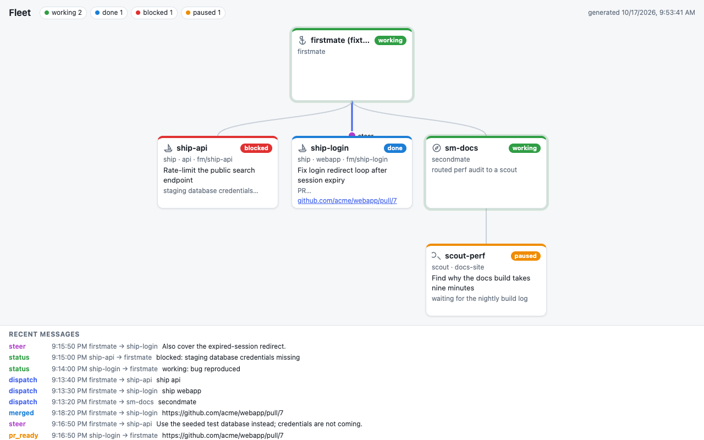

# Fleet dashboard

The dashboard is a local web page that draws the fleet as an org chart.
The firstmate is on top, its second mates are in the row below, and every ship and scout sits under the mate that runs it.
Each card shows the mate's state, project, branch, task title, latest status text, and PR link.
Messages between mates move along the lines as colored dots, so you can watch work being dispatched, steered, reported and merged.



## Open it

Run this from the firstmate checkout:

```sh
FM_HOME=/path/to/home factory/bin/sf-dashboard.sh
```

Then open <http://127.0.0.1:8765/> in a browser.
`FM_HOME` defaults to the checkout itself.
Use `--port N` to pick another port, or `--port 0` to take any free port; the script prints the URL it bound.
The server listens on 127.0.0.1 only and stops on Ctrl-C.
The page needs no network and loads no outside files.

`--once` prints the graph as JSON (schema `sf-dashboard.v1`) and exits, for tests and other tools.

## Requirement: the fleet activity ledger

Message flow comes from the fleet activity ledger described in [`docs/fleet-ledger.md`](../../docs/fleet-ledger.md).
Turn it on by creating the empty file `config/fleet-ledger` in the home.
While it is off, the page shows a red banner and draws mates without messages.
Steer messages come from each task's steering inbox, so they show up either way.

## What the colors mean

The colored bar on top of each card and its badge show the mate's state.
The states are the ones `bin/fm-crew-state.sh` prints.

| State   | Color  | Meaning |
| ------- | ------ | ------- |
| working | green  | The mate is busy; its card pulses. |
| parked  | grey   | Idle and waiting for work. |
| done    | blue   | Finished its task. |
| blocked | red    | Stuck and needs help from its lead. |
| paused  | orange | Deliberately waiting for something expected to clear. |
| failed  | maroon | The task failed. |
| unknown | slate  | The state could not be read. |

The firstmate has no state of its own in the snapshot, so it shows working while any mate under it is working, and parked otherwise.

Message dots and the history strip use one color per message kind: dispatch indigo, steer purple, status green, PR ready orange, merged blue, cleaned up grey.
Dispatch, steer, merged and cleaned up travel from the firstmate down to the worker.
Status and PR ready travel up from the worker to the firstmate.

## Where the data comes from

- Mates, tasks and second mates come from `bin/fm-fleet-snapshot.sh --json`.
- Workers under a second mate come from that second mate's summary in the snapshot.
  Their messages live in the second mate's own ledger, so they show no moving dots here.
- Messages come from `state/fleet-ledger.jsonl` and from `state/<id>.inbox/`, both handled and unhandled.
- `state/<id>.meta` fills in kind, project, branch and PR when the snapshot lacks them.

The page polls every 3 seconds.
Each new message animates once, in order, and the strip at the bottom lists the last 20.
On first load the page replays those last 20 so you see recent flow right away.
Message numbers are positions in time order, not stored ids, and a truncated ledger restarts them.

The dashboard reads only.
It never writes under `state/` or `data/`.
`bin/fm-fleet-snapshot.sh` may refresh its own cached summaries of remote second mates, as its header describes.

## Fixture mode

`--fixture <dir>` reads a recorded home instead of the live one:

- `<dir>/fleet-snapshot.json`: a saved `fm-fleet-snapshot.sh --json` output;
- `<dir>/recorded-state/`: files laid out like `state/`;
- `<dir>/recorded-config/`: files laid out like `config/`.

The folders are not named `state/` and `config/` because the repository ignores those names everywhere.
`factory/tests/fixtures/dashboard/` is the demo: a firstmate, one second mate, two ships and a scout in mixed states, with a full dispatch, steer, status, PR ready and merged sequence.

```sh
factory/bin/sf-dashboard.sh --fixture factory/tests/fixtures/dashboard
```

`factory/tests/sf-dashboard.test.sh` runs the same fixture.
